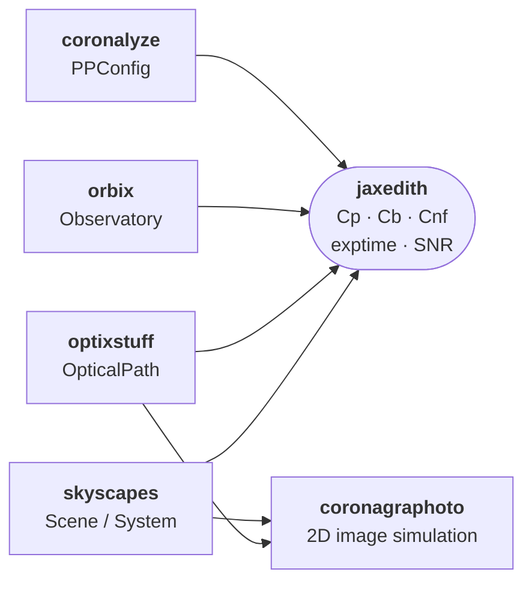

<p align="center">
  <a href="https://pypi.org/project/jaxedith/"></a>
  <a href="https://jaxedith.readthedocs.io"></a>
  <a href="https://github.com/CoreySpohn/jaxedith/actions/workflows/ci.yml"></a>
  <a href="https://github.com/CoreySpohn/jaxedith/blob/main/LICENSE"></a>
  <a href="https://github.com/CoreySpohn/jaxedith/blob/main/pyproject.toml"></a>
</p>

# jaxedith

The JAX-native exposure-time-calculator kernel for an HWO direct-imaging
stack.

`jaxedith` returns scalar count rates, exposure times, and SNR
predictions from a coronagraph + scene + observation triple. It is the
**fast inner loop** for yield calculations, sensitivity studies, and
retrievals where the ETC has to be differentiable, `vmap`-able, and
JIT-able end-to-end.

Count rates are in electrons per second. The intermediate adapters apply
`detector.get_qe(wavelength_nm) * detector.dqe` exactly once; attenuating
elements in the optical path must not also include detector QE. Read-noise
variance is divided by the detector frame time, with one read per frame.

If you want a friendly, general-purpose AYO exposure-time calculator
with a standalone Python API,
[pyEDITH](https://github.com/eleonoraalei/pyEDITH/) is the right tool.
`jaxedith` is the same AYO / pyEDITH ETC heritage rebuilt as a JAX
kernel for an HWO direct-imaging stack: it takes
[skyscapes](https://github.com/CoreySpohn/skyscapes) +
[optixstuff](https://github.com/CoreySpohn/optixstuff) +
[orbix](https://github.com/CoreySpohn/orbix) +
[coronalyze](https://github.com/CoreySpohn/coronalyze) types as
inputs, prioritises JAX fitness (JIT, vmap, grad) over ergonomics, and
is meant to be called by other stack code, not picked up standalone.
The EXOSIMS detection and characterization variants are exposed via
parallel function families.

Three properties define the design:

- **Pure JAX.** Public functions are JIT-compatible and `vmap`-able.
  Continuous rate equations are differentiable; fixed-frame boundaries
  and discrete exposure planning have the derivative conventions below.
- **Variant-explicit API.** Three ETC equations (AYO, EXOSIMS
  detection, EXOSIMS characterization) live in three parallel function
  families (`exptime_ayo`, `exptime_exosims_det`,
  `exptime_exosims_char`) with no runtime dispatch — JIT caches one
  trace per variant.
- **Two usage modes.**
  - *Scalar mode* (`exptime_ayo(optical_path, scene, ...)`) takes an
    `optixstuff.OpticalPath` plus an `ETCScene` dataclass of
    astrophysical scalars — useful for parameter sweeps and tests.
  - *System mode* (`exptime_from_system_ayo(system, optical_path,
    observatory, exposure, ppconfig)`) accepts a full
    `skyscapes.System` + `optixstuff.OpticalPath` +
    `orbix.observatory.Observatory` + `optixstuff.ExposureConfig` +
    `coronalyze.PPConfig`, extracts per-(planet, epoch) astrophysics,
    and `jax.vmap`s the scalar core over `(K, T)`.

## Fixed-frame finite exposures

The AYO defaults retain `cadence="photon_counting_ayo"`. Select
`cadence="fixed_frame"` on `count_rates_ayo`, `snr_ayo`, `exptime_ayo`, or
their `*_from_system_ayo` wrappers for a detector with fixed integration
frames. `count_rates_ayo` then returns photon-only `Cb` and the stellar floor
rate `Cnf = leakage / ppfact`. An infinite `ppfact` disables that floor.
The fixed-frame cadence uses only the stellar systematic floor; `ez_ppf`
continues to apply to the legacy cadence.

For science integration time `t`, the count variance is

```text
Cp*t + k*Cb*t + n_pix*(dark*t + (read_noise**2 + cic)*frame_count(t, frame_time))
    + (Cnf*t)**2
```

Here `k` is the `bg_multiplier` keyword (default 2). It scales photon
backgrounds only. Dark current accumulates with integration time, while read
variance and CIC are paid per frame, including a partial final frame. The
independent shot, dark, and read terms follow the CCD equation in S. B.
Howell, *Handbook of CCD Astronomy*, second edition (Cambridge University
Press, 2006). CIC adds an independent Poisson contribution per read; the
systematic term is a correlated residual proportional to exposure time.

Use `count_variance_components(system, optical_path, observatory, exposure,
ppconfig, t, cadence="fixed_frame", bg_multiplier=2, ppfact=...)` to inspect
`planet`, `background`, `detector`, `systematic`, and `total` variances as
`(K, T)` arrays. The scalar-scene counterpart is
`count_variance_components_ayo(optical_path, scene, wavelength_nm,
separation_lod, dlambda_nm, t, ...)`. The system budget and SNR wrappers
remove observatory overheads and divide time among rolls; the scalar budget
and rate-level functions take science time directly. System wrappers accept
`ppfact=None` to use `ppconfig.ppfact`, or an explicit value to override it.
They also thread `cadence` and, for variance/SNR/exposure, `bg_multiplier`.

Fixed-frame exposure planning defaults to `planning="whole_frames"`. The call
below shows the keywords and is not run as a test: it needs a `system`,
`optical_path`, `observatory`, `exposure` and `ppconfig` already built.

```python notest
t = exptime_from_system_ayo(
    system,
    optical_path,
    observatory,
    exposure,
    ppconfig,
    target_snr,
    cadence="fixed_frame",
    planning="whole_frames",
    n_max=4096,
    bg_multiplier=2.0,
    ppfact=float("inf"),
)
```

`planning="min_duration"` permits a partial final frame and selects the first
feasible quadratic root across frame intervals. SNR drops at each additional
read, so its feasible durations can have gaps. Both planners return infinity
when no duration through `n_max` frames per roll meets the target, including
targets at or above the systematic ceiling `Cp / Cnf`. Exposure wrappers add
configured overheads after solving for science time.

The rate-level API is also exported from `jaxedith`. The block lists the
signatures; it is not a runnable example.

```python notest
frame_count(t, frame_time)
detector_variance_counts(t, n_pix, dark, read_noise, cic, frame_time)
snr_fixed_frame(
    Cp, Cb, Cnf_rate, t, n_pix, dark, read_noise, cic, frame_time, bg_multiplier=2.0
)
exptime_whole_frames(
    target_snr,
    Cp,
    Cb,
    Cnf_rate,
    n_pix,
    dark,
    read_noise,
    cic,
    frame_time,
    bg_multiplier=2.0,
    n_max=4096,
)
exptime_min_duration(
    target_snr,
    Cp,
    Cb,
    Cnf_rate,
    n_pix,
    dark,
    read_noise,
    cic,
    frame_time,
    bg_multiplier=2.0,
    n_max=4096,
)
```

Zero science time incurs no frames or detector variance and gives SNR zero;
a non-positive target needs zero science time. All numeric inputs can be
batched with JAX. `cadence`, `planning`, and `n_max` must be static under JIT.
`frame_count` treats ratios within relative tolerance `1e-12` of a positive
integer as exact; enable JAX float64 to resolve this tolerance. Its JAX
derivative is zero, including at discontinuities. Frame-based planning is
discrete; its derivatives are not a continuous exposure sensitivity model.

## What jaxedith is *not*

- **Not an image simulator.** 2D detector images and post-processing
  live in [coronagraphoto](https://github.com/CoreySpohn/coronagraphoto)
  and [coronalyze](https://github.com/CoreySpohn/coronalyze).
  `jaxedith` predicts the integrated scalar count rates the image
  simulator's outputs would yield.
- **Not a scene model.** Scenes (`Star`, `Planet`, `Disk`, physical
  models, backgrounds) live in
  [skyscapes](https://github.com/CoreySpohn/skyscapes). `jaxedith`
  consumes them via the `_from_system_*` wrappers.
- **Not a yield simulator.** Mission-scale loops over many targets +
  visit scheduling live in dedicated yield codes (e.g. AYO,
  EXOSIMS). `jaxedith` is the per-target ETC kernel those codes can
  invoke.

## Ecosystem position



## Architecture

Four modules organized as a left-to-right pipeline:

```
primitives → intermediates → etc → public
```

| Module | Role | Signature shape |
|---|---|---|
| `jaxedith.primitives` | Scalar building blocks | `(scalars...) → rate` |
| `jaxedith.intermediates` | `OpticalPath` adapters, one per noise-budget term (signal, background, noise floor) | `(optical_path, scalars...) → rate` |
| `jaxedith.etc` | Closed-form exptime + SNR algebra | `(rates, snr or t_obs, ...) → exptime or snr` |
| `jaxedith.public` | Variant-explicit user entry points + system wrappers | `(optical_path, scene, ...) → exptime or snr` |

Each layer composes the previous; the module name tells you the role
at that level of abstraction. Most users only call `public.*`; the
lower layers are exposed for advanced use (testing, custom budgets,
sensitivity studies).

## Variants

Three ETC equations, each with three entry-point flavours (count
rates, exposure time, SNR):

| Variant | Origin | Background multiplier | Noise floor |
|---|---|---|---|
| `ayo` | AYO / pyEDITH | 2× (ADI assumption) | analytical `Cnf_rate = raw_contrast × ppfact` |
| `exosims_det` | EXOSIMS detection | 1× | speckle residual `Csp` |
| `exosims_char` | EXOSIMS characterization | 1× + `Cp` self-noise | speckle residual `Csp` |

Pick the variant that matches your reference convention; no runtime
dispatch.

## Quick start

Scalar mode (you've got the astrophysical scalars in hand):

This template needs a configured optical path; the ellipsis is a placeholder.

```python notest
from jaxedith import ETCScene, exptime_ayo
import optixstuff as ox

# Build the hardware
optical_path = ox.OpticalPath(...)

# Build the scene (8 dimensionless scalars + 2 geometric)
scene = ETCScene(
    F0=1.34e8,  # flux zero point [ph/s/m^2/nm]
    Fs_over_F0=0.005,  # stellar / zeropoint
    Fp_over_Fs=1e-10,  # planet-star contrast
    Fzodi=3.5e-10,  # local zodi surface brightness ratio
    Fexozodi=7.15e-9,  # exozodi at 1 AU
    dist_pc=10.0,
    sep_arcsec=0.1,
    Fbinary=0.0,
)

t_exp = exptime_ayo(
    optical_path,
    scene,
    wavelength_nm=500.0,
    separation_lod=5.0,
    dlambda_nm=100.0,
    snr=7.0,
)
```

System mode (you have a `skyscapes.System`):

This example needs a user-supplied system, optical path, and orbit data.

```python notest
import jax.numpy as jnp
import optixstuff as ox
from coronalyze import PPConfig
from jaxedith import exptime_from_system_ayo, zodi_fn_ayo
from orbix.observatory import Observatory, ObservatoryL2Halo

t_exp = exptime_from_system_ayo(
    system,
    optical_path,
    observatory=Observatory(orbit=ObservatoryL2Halo.from_default()),
    exposure=ox.ExposureConfig(
        start_time_jd=jnp.array([2_460_000.5]),
        exposure_time_s=jnp.asarray(3600.0),
        central_wavelength_nm=jnp.asarray(500.0),
        bin_width_nm=jnp.asarray(20.0),
        position_angle_deg=jnp.asarray(0.0),
    ),
    ppconfig=PPConfig(ppfact=1.0, n_rolls=1, ez_ppf=jnp.inf),
    snr=7.0,
    zodi_fn=zodi_fn_ayo,
)
# t_exp shape (K, T): one exptime per (planet, epoch)
```

## Installation

```bash
pip install jaxedith
```

For GPU acceleration, install JAX with a CUDA build separately (see
the [JAX install guide](https://docs.jax.dev/en/latest/installation.html)).

## Status

Early development. The public API was consolidated in May 2026 as
part of a workspace-wide v1.0 cycle; breaking changes will be flagged
via release-please major-bump tags.
